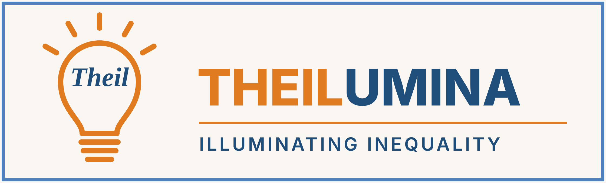
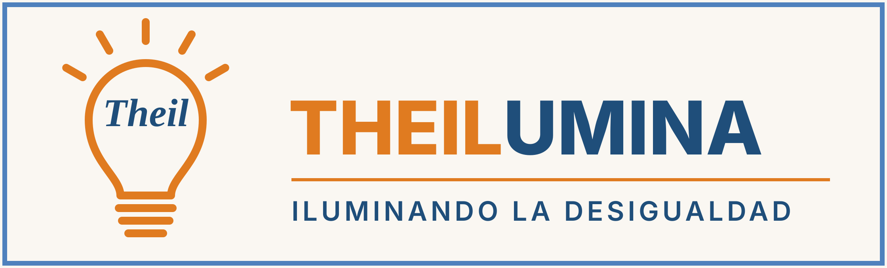
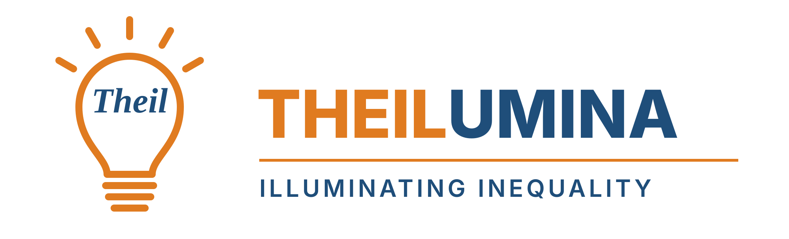
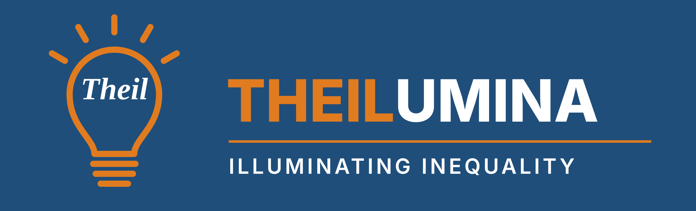
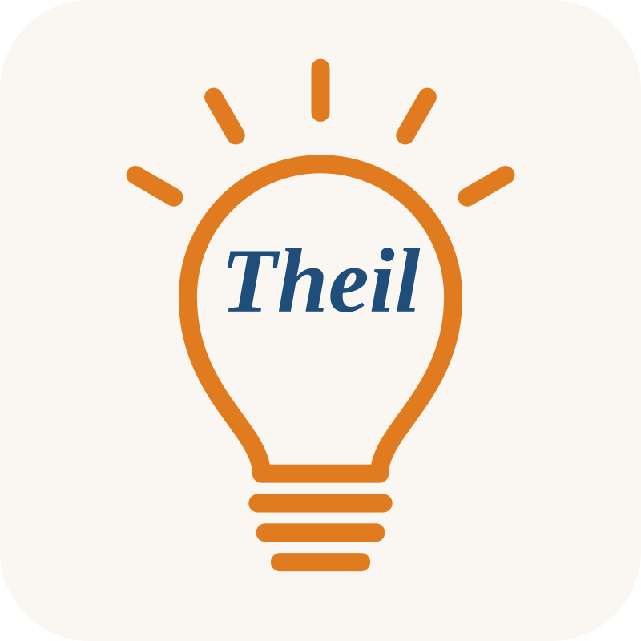
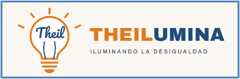

Co-authors, collaborators and institutions can use the THEILUMINA logo in presentations, posters, papers, websites and social media about work related to the project.

[Download the complete identity kit (ZIP)](images/brand/theilumina_brand_kit.zip){.btn .btn-primary}

## Logos

::: {.brand-grid}

::: {.brand-card}
{fig-alt="THEILUMINA logo, English version"}

**Main logo (English)**\
[PNG](images/brand/theilumina_logo_en.png){download=""} · [SVG](images/brand/theilumina_logo_en.svg){download=""}
:::

::: {.brand-card}
{fig-alt="THEILUMINA logo, Spanish version"}

**Main logo (Spanish)**\
[PNG](images/brand/theilumina_logo_es.png){download=""} · [SVG](images/brand/theilumina_logo_es.svg){download=""}
:::

::: {.brand-card}
{fig-alt="THEILUMINA logo without background"}

**Transparent background**\
[PNG](images/brand/theilumina_logo_en_transparent.png){download=""} · [SVG](images/brand/theilumina_logo_en_transparent.svg){download=""}
:::

::: {.brand-card .brand-dark}
{fig-alt="THEILUMINA logo for dark backgrounds"}

**Dark backgrounds**\
[PNG](images/brand/theilumina_logo_en_negative.png){download=""} · [SVG](images/brand/theilumina_logo_en_negative.svg){download=""}
:::

::: {.brand-card}
{fig-alt="THEILUMINA icon" width=40%}

**Icon (small sizes, social media)**\
[PNG](images/brand/theilumina_icon.png){download=""} · [SVG](images/brand/theilumina_icon.svg){download=""}
:::

::: {.brand-card}
{fig-alt="Original THEILUMINA logo"}

**Original logo**\
[PNG](images/logo_theilumina.png){download=""}
:::

:::

## Colours and typeface

Orange #E07B20

Blue #1F4E7A

Frame #4F81BD

Cream #FAF7F2

Typeface: [Source Sans 3](https://fonts.google.com/specimen/Source+Sans+3) (open licence).

## Guidelines

- Keep the proportions of the logo and leave some free space around it.
- Do not change the colours; on dark backgrounds use the version for dark backgrounds.
- Use the icon only when the full logo would be too small to read.
- When possible, link the logo to the project website: <https://jfmunozrosas.github.io/theilumina/>.

## Suggested acknowledgement

If your work is related to the project, you can use this text (adapt it once the project is funded and has a reference number):

> This work is related to the research project proposal THEILUMINA (*Illuminating inequality with Theil indices: bias, precision, computational efficiency and decomposition, with multidisciplinary applications*), University of Granada, Spain.
