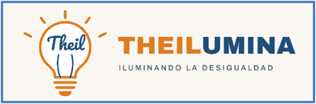

::: {.hero}
{width=60% fig-alt="THEILUMINA logo"}

Bias, precision, computational efficiency and decomposition of Theil indices, with multidisciplinary applications in the Social Sciences.

:::

## About THEILUMINA

**THEILUMINA** is a research project of the University of Granada (Spain) that develops new methods to estimate Theil inequality indices ($T_0$ and $T_1$) and to make reliable inferences about them. It builds on the previous project [GiniUs](https://cran.r-project.org/package=giniVarCI) on the Gini index.

Theil indices are widely used because, unlike the Gini index, they can be additively decomposed into inequality **between** groups and inequality **within** groups. However, their estimators can be severely biased, and their confidence intervals unreliable, when data are highly skewed and unequal, which is precisely where measuring inequality matters most.

The project:

- diagnoses, predicts and corrects the bias of the estimators of $T_0$ and $T_1$;
- provides reliable variance estimators and confidence intervals, based on the jackknife;
- reduces the computational cost of the jackknife to make inference feasible with large samples;
- develops the open-source R package **theil**, with a C++ core;
- transfers these methods to water economics, tourism, servitization and digital transformation of firms, and global convergence.

## What this website offers

This website is a working tool for the research team and an open resource for other researchers:

1. **Communication and collaboration.** Data, R code, results and conclusions are shared among team members.
2. **Reproducible research.** Anyone can run the code and obtain the same tables and figures.
3. **Interactivity.** The [bias explorer](simulation.qmd) lets users see how bias changes with skewness, inequality and sample size.
4. **Dissemination and internationalisation.** Results, data and software are openly available.

## Funding

::: {.pending}
Proyectos de Generación de Conocimiento — convocatoria 2026. Agencia Estatal de Investigación. Reference: *pending*.
:::

<!-- Añadir aquí los logos del Ministerio, AEI y FEDER cuando se conceda el proyecto:
{width=30%} {width=30%} {width=30%}
-->
