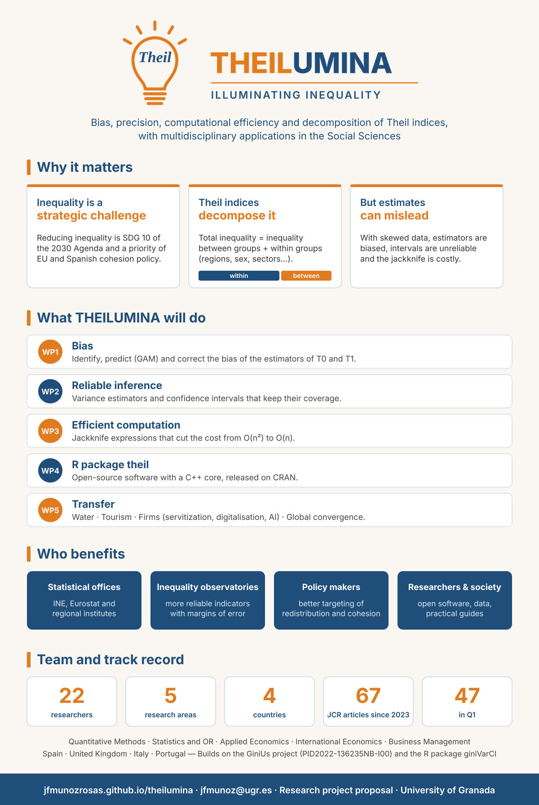

::: {.hero}
{width=60% fig-alt="THEILUMINA logo"}

<p class="tagline">Bias, precision, computational efficiency and decomposition of Theil indices, with multidisciplinary applications in the Social Sciences.</p>

<p class="hero-badge"><span class="badge-status">Research project proposal · Under evaluation</span></p>
:::

## THEILUMINA in one minute

```{=html}
<div class="video-wrap">
<video controls preload="metadata" playsinline poster="media/theilumina_video_poster.jpg">
  <source src="media/theilumina_video_en.mp4" type="video/mp4">
  Your browser cannot play this video. <a href="media/theilumina_video_en.mp4">Download it</a>.
</video>
</div>
```

## Project status



## About THEILUMINA

**THEILUMINA** is a **research project proposal** led by the University of Granada (Spain) that develops new methods to estimate Theil inequality indices ($T_0$ and $T_1$) and to make reliable inferences about them. It builds on the previous project [GiniUs](https://jfmunozrosas.github.io/ginius/){target="_blank"} (PID2022-136235NB-I00) on the Gini index, which produced the R package [giniVarCI](https://cran.r-project.org/package=giniVarCI).

Theil indices are widely used because, unlike the Gini index, they can be additively decomposed into inequality **between** groups and inequality **within** groups. However, their estimators can be severely biased, and their confidence intervals unreliable, when data are highly skewed and unequal, which is precisely where measuring inequality matters most. The [research problems and questions](research.qmd) page illustrates these problems with preliminary results.

The project:

- diagnoses, predicts and corrects the bias of the estimators of $T_0$ and $T_1$;
- provides reliable variance estimators and confidence intervals, based on the jackknife;
- reduces the computational cost of the jackknife to make inference feasible with large samples;
- develops the open-source R package **theil**, with a C++ core;
- transfers these methods to water economics, tourism, servitization and digital transformation of firms, and global convergence.

## From GiniUs to THEILUMINA

::: {.ginius-box}

**GiniUs** (PID2022-136235NB-I00) is the previous project of the team, on the bias and inference of the **Gini index**. THEILUMINA extends its methods to Theil indices. On the [GiniUs website](https://jfmunozrosas.github.io/ginius/){target="_blank"} you can find its results, open tools (Gini index calculator, missing data simulator, R exercises), the [Impact page](https://jfmunozrosas.github.io/ginius/impact.html){target="_blank"} and **one-minute videos** that explain the team's articles in plain language.

[Visit GiniUs →](https://jfmunozrosas.github.io/ginius/){.btn .btn-outline-primary .btn-sm target="_blank"} [All the videos →](https://jfmunozrosas.github.io/ginius/videos.html){.btn .btn-outline-primary .btn-sm target="_blank"}
:::

::: {.video-grid}
<a href="https://jfmunozrosas.github.io/ginius/videos.html#gini-practical-guide" target="_blank"><span class="vt">How to estimate the Gini index without errors</span></a>
<a href="https://jfmunozrosas.github.io/ginius/videos.html#gini-bias" target="_blank"><span class="vt">The bias of the Gini index</span></a>
<a href="https://jfmunozrosas.github.io/ginius/videos.html#happy-and-poor" target="_blank"><span class="vt">The “happy and poor” paradox</span></a>
<a href="https://jfmunozrosas.github.io/ginius/videos.html#water-sanitation-growth" target="_blank"><span class="vt">Does growth make access to water more equal?</span></a>
:::

## The project at a glance

[{fig-alt="THEILUMINA project infographic" .infographic}](images/theilumina_infographic.png)

<p class="source">Click on the infographic to open it at full size. Download: [PNG](images/theilumina_infographic.png) · [SVG](images/theilumina_infographic.svg).</p>

## Latest news

::: {.news-mini}
- **November 2026** · [Previous publications of the team](publications.qmd#previous-publications) now show open access, [one-minute videos](https://jfmunozrosas.github.io/ginius/videos.html), citations and online attention, as in the previous project [GiniUs](https://jfmunozrosas.github.io/ginius/).
- **November 2026** · New tools: [Theil index calculator](calculator.qmd), [R exercises in your browser](practice.qmd), [world inequality map](observatory.qmd#world-map-of-inequality), [blog](blog/index.qmd) and [glossary](glossary.qmd).
- **November 2026** · New [Practical guides](guides.qmd) section, starting with a guide to estimating and decomposing Theil indices in R.
- **November 2026** · [Conferences of interest in 2027](dissemination.qmd#upcoming-conferences-2027): ECINEQ, IARIW, ISI WSC, EcoSta and more.
- **November 2026** · A one-minute video and an infographic present the project.
:::

[All news →](news.qmd){.btn .btn-outline-primary .btn-sm}

## What this website offers

This website is a working tool for the research team and an open resource for other researchers:

1. **Communication and collaboration.** Data, R code, results and conclusions are shared among team members.
2. **Reproducible research.** Anyone can run the code and obtain the same tables and figures.
3. **Interactivity.** The [bias explorer](simulation.qmd) lets users see how bias changes with skewness, inequality and sample size.
4. **Inequality observatory.** The [observatory](observatory.qmd) shows official inequality indicators (Gini, S80/S20 and Theil indices) from Eurostat, the World Bank and the Spanish Statistical Office (INE), with links to other inequality observatories.
5. **Practical guides and tools.** The [practical guides](guides.qmd) explain in detail how to estimate, decompose and make inferences about Theil indices; the [calculator](calculator.qmd) applies them to your own data and the [R exercises](practice.qmd) run in your browser.
6. **Dissemination and internationalisation.** Results, data and software are openly available, and the [project identity](identity.qmd) can be freely used by co-authors and collaborators.
7. **Collaboration.** External researchers interested in the project can [contact us](contact.qmd).

## Your opinion

Is this website useful to you? Rate it with one click and leave us your recommendations.


